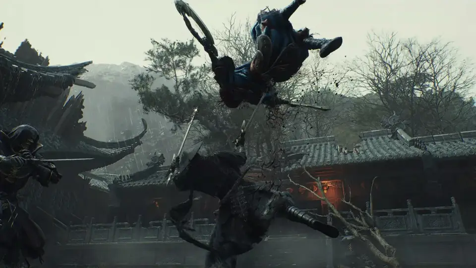
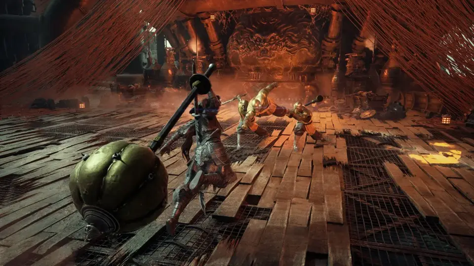

S-Game, the Chinese studio behind Phantom Blade Zero, clearly understands the core tenets of character-action games. If your melee combat isn’t tight, responsive, and oozing cool, then what’s the point? Some games might have better combat, but few can match Phantom Blade Zero’s style. 

Every moment feels like you’re in the middle of a Chinese martial-arts movie, pulling off moves that shouldn’t be feasible–moves that go against what we expect from third-person action games–yet are baked into the mechanics. The game is not without issues, and they do hold it back from reaching the genre’s upper echelons, but the highs are stratospheric.

Advertisement

Character-action games aren’t typically known for telling riveting stories, and Phantom Blade Zero is no different. You play as Soul, a stoic assassin who dies in the game’s opening moments when a sword tears through his heart. Soon after, a mysterious figure gives him a chance to come back from the dead, forcing him to choose between two artificial hearts. One will allow him to live but strip away all of his emotions, while the other will let him retain those emotions but only give him 66 days left on this mortal coil. Soul chooses the latter, setting up a 66-day quest to find a cure, unravel a conspiracy, and prove that he was framed for his master’s murder.

It’s a fairly ridiculous opening, but one that doesn’t reflect the rest of the game. Much of Phantom Blade Zero’s narrative unfolds through background machinations: in clandestine conversations, hidden notes, and secondhand information. Multiple organizations, people, and malicious schemes are in play, but it doesn’t do a particularly good job of filling you in, so I found it tough to keep track of who’s who and what’s what. Some aspects eventually come into sharper focus toward the end of the game, but this feels like too little, too late.

You’re essentially dropped into an established world where even the protagonist knows more than you do, referencing past events and showing familiarity with characters new to you. All you can do is attempt to piece together some kind of understanding through the notes and loading-screen tooltips, but even then you’ll still be in the dark for a good chunk of the game’s dialogue. 

There are some cool storytelling moments here and there, such as the way it uses hand-drawn watercolor animation whenever it flashes back to Soul’s childhood. One sequence also features traditional Chinese shadow puppets (or Piyingxi) to explore a character’s backstory. Repeating or explaining plot points during loading screens feels like a concession to its failures elsewhere, though, and ultimately, I found it difficult to latch onto anything that would make me care about the story. 

Unsurprisingly, combat is Phantom Blade Zero’s bread and butter. It’s also unlike anything else I’ve played, essentially translating the choreographed action of films like Hero and Crouching Tiger, Hidden Dragon to a playable medium. Both movies are known as Wuxia, a Chinese genre of fiction and low fantasy that blends martial arts with fantastical elements. Wuxia fight scenes are known to be incredibly fluid and dynamic: half combat, half choreographed dance, with both sides attacking and defending at the same time, creating a calculated but frenetic spectacle of clashing steel. 

Advertisement
Phantom Blade Zero

The choreography isn’t something you can replicate in video games without resorting to quick-time events, but Phantom Blade Zero still makes it look and feel like you’re engaged in a cinematic, free-flowing dance to the death. You have light and heavy attacks at your disposal, with combos alternating between the two. The key is that these attacks require no commitment. 

There’s never a point where an attack begins and locks you into an animation until it ends. Switching to defense–either to block or parry–is instantaneous, even if you’re mid-combo. Some attacks will even deflect incoming strikes automatically, recreating the back-and-forth, simultaneous attack-and-defend action Wuxia is known for. The whole thing is antithetical to the call-and-response philosophy of so many other action games, but it works when enemies test your abilities.

Sometimes, particularly during boss battles, you still need to focus strictly on offense or defense–maybe because you’ve created an opening to counterattack or need to lock in and parry multiple strikes in quick succession–but the delineation isn’t as common as it is elsewhere. Most combat encounters achieve this satisfying flow through speed, aggression, and how combos and parries gracefully intersect. Sure, you could sit back and wait for your opponent to attack, or you could rush in and deal damage while still watching for their attack cues. Every action you take is fast and responsive, and even the biggest, heaviest weapons are swung at a rapid pace.

Much of this fluidity comes from the game’s excellent motion capture, which showcases each movement with the smoothness and intent you’d expect from seasoned martial artists. It’s also complemented by an eclectic soundtrack that infuses the action with everything from Chinese rap, metal, and pop to somber piano pieces and electronic beats.

There’s mechanical depth beyond the surface panache, too. These mechanics are more par for the course, but familiarity is important when trying something new. Sha-Chi, for instance, is Phantom Blade Zero’s stamina system. The meter drains when you hold down the block button or perform heavy attacks, but successful parries will severely deplete your opponent’s Sha-Chi instead, gradually breaking their guard and leaving them vulnerable to a flurry of offense. Blue and red flash attacks also denote special, telegraphed moves you need to either parry or dodge, with both tightening up the window for you to react.

Advertisement

Failing to do so will eat into your health bar, but depleting your Sha-Chi meter also takes you out of action for a few seconds. To counteract this, switching weapons quickly replenishes your Sha-Chi, letting you maintain the initiative with a different armament. You can equip two primary weapons to alternate between, which not only helps you manage your Sha-Chi, but also gives you more combat options when you consider how varied Phantom Blade Zero’s plethora of swords, axes, and spears are.

Each one feels unique when executing your standard light and heavy attacks, and they all have various intricacies that unlock as you level them up. For a good chunk of the game, I used a sword called the Outlaw Warblade. With this two-handed weapon, heavy attacks deal increased damage by eating into your health, which switching to standard attacks then restores. It can be a risky but effective weapon to use, but one I wasn’t afraid to equip knowing I could quickly switch to another weapon.

Whether it’s a broken blade that transforms into a ranged weapon after drinking–while also making you move like Jackie Chan in Drunken Master–or a pair of swords that summon the power of both wind and thunder, the weapons on offer are incredibly fun to use. They’re flexible, too, with an upgrade system that lets you refund and recover the materials you’ve spent, so you never feel locked into using a particular weapon just because you’ve spent time upgrading it. You’re free to experiment and jump from one completely different arsenal to the next, which is a more than welcome choice.  

Each weapon also has a secondary attack that breaks the non-committal rule. Landing heavy attacks builds Sha-Chi Essence, which you can then spend on weapon-specific techniques called Power Surges. While some of these might enhance your offense for a short time, others unleash devastating combos that you can’t cancel out of, forcing you to consider when the opportune time to utilize them is. 

Phantom Blade Zero

The same is true of Phantom Edges: secondary weapons you can use a limited number of times before needing to replenish their stock. These range from heavy axes that can break through shields and armor to ranged weapons, chained sickles, flying guillotines, and a magical bell that can summon puppets to fight by your side. Both Power Surges and Phantom Edges add another layer to Phantom Blade Zero’s flashy combat, upping the ante in desperate situations or providing that extra oomph you need to finish off a boss.

Advertisement

Boss battles are where the game’s combat truly sings: where spectacle and cinematic action are pushed to the forefront, with free-flowing and thrilling mechanics to back it all up. Whether it’s a Lion Dancer that breathes fire and hops between wooden plinths, or a three-faced puppet summoning giant paper snakes from the earth, the bosses are distinct and built on spectacle. It’s no surprise that these conflicts represent Phantom Blade Zero at its most challenging. It might not be a soulslike, but From Software’s influence is felt here and elsewhere. 

The world, which blends a traditional kung-fu aesthetic with steampunk machinery and body modification, is all S-Game. The studio calls this style “kungfupunk,” and it’s an accurate descriptor, melding pagodas with industrial iron and billowing smoke. 

There’s variety within this conceit, too. At one point, you traverse a once-verdant forest that’s now crimson, stained red after a brutal battle, “as though the forest itself were weeping blood.” Another area sees you using a steam-powered boat to navigate a vast lake dotted with islands, while you’ll also venture into a town whose denizens have been transformed into wooden puppets, and a winding valley with waterfalls and cliffs overlooking its crystal-clear streams. 

It’s a strongly realized world, but the level design is distinctly soulslike, with circuitous areas full of branching paths and looping shortcuts. It’s one of the strongest examples of this type of level design, making each locale a treat to explore, though it doesn’t always feel entirely necessary. 

Soulslike checkpoints let you replenish health and upgrade weapons and items, but crucially, they don’t respawn enemies as you would expect. It’s an odd choice, especially since enemies stay dead even after you die. This changes the dynamic of enemy encounters, essentially letting you whittle down a group of enemies even if they get the better of you.

Advertisement

This speaks to Phantom Blade Zero’s overall leniency, though. Many of its boss battles contain multiple phases, but if you reach the second phase and die, you don’t have to repeat the first. I’m a fan of this decision, because if I’ve already demonstrated I can beat the first phase, forcing me to do so again can be frustrating. 

There are also three difficulty levels to choose from. You can swap between them at any time, which is something I took advantage of to make some of the regular enemy encounters more interesting. This is Phantom Blade Zero’s biggest flaw, as even on the hardest difficulty, it’s too easy to simply button-mash your way to victory against most enemy types. Groups still gave me trouble on occasion, especially since switching lock-on targets in these instances is overly cumbersome, but as I mentioned earlier, taking out a few enemies is beneficial even if you die. 

As someone who plays these kinds of games a lot, this might not be the same experience for everyone. Yet the bosses still posed enough of a challenge that I had to bump the difficulty back down to medium, so it feels more like a wildly unbalanced swing than anything else.

It’s disappointing because, under the right circumstances, Phantom Blade Zero’s combat is spectacular. Its Wuxia-inspired action nails the free-flowing, back-and-forth nature of its kinetic influences with aplomb. Being able to cleave through dozens of enemies who barely put up a fight isn’t a fatal flaw, but tedium, and the fact you know how thrilling combat can be makes it a more glaring issue. It’s this misstep that holds Phantom Blade Zero back, but it’s still a fantastic game that any action aficionado should lap up.
