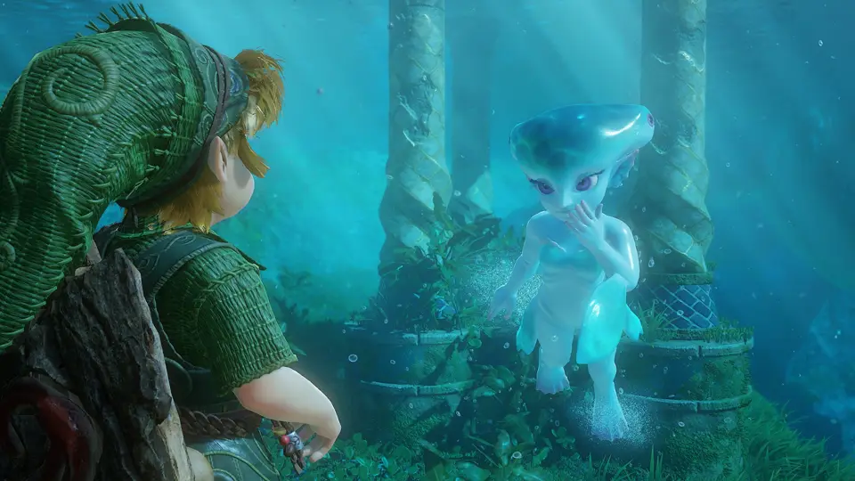
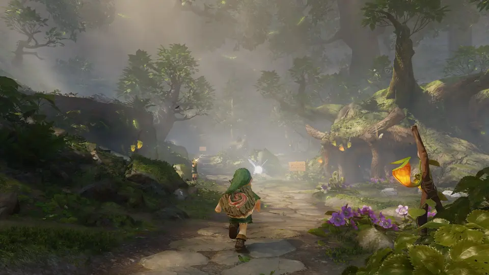
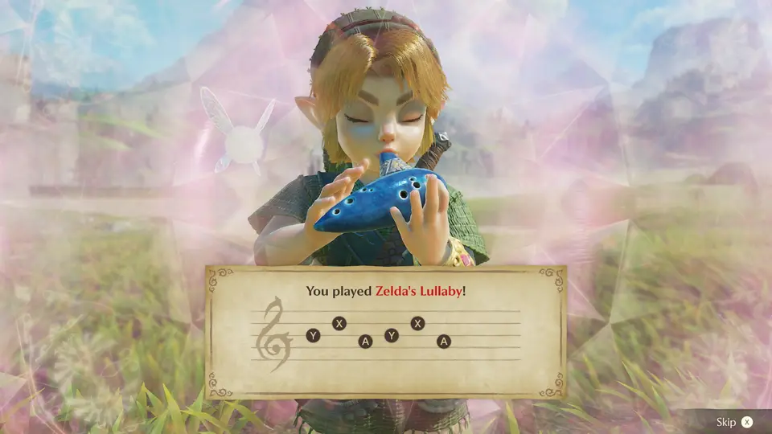
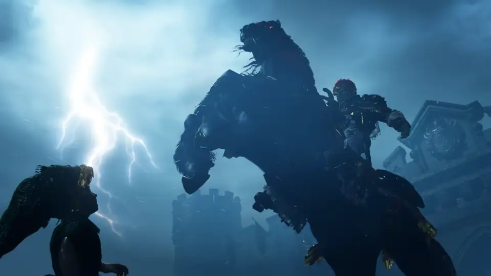
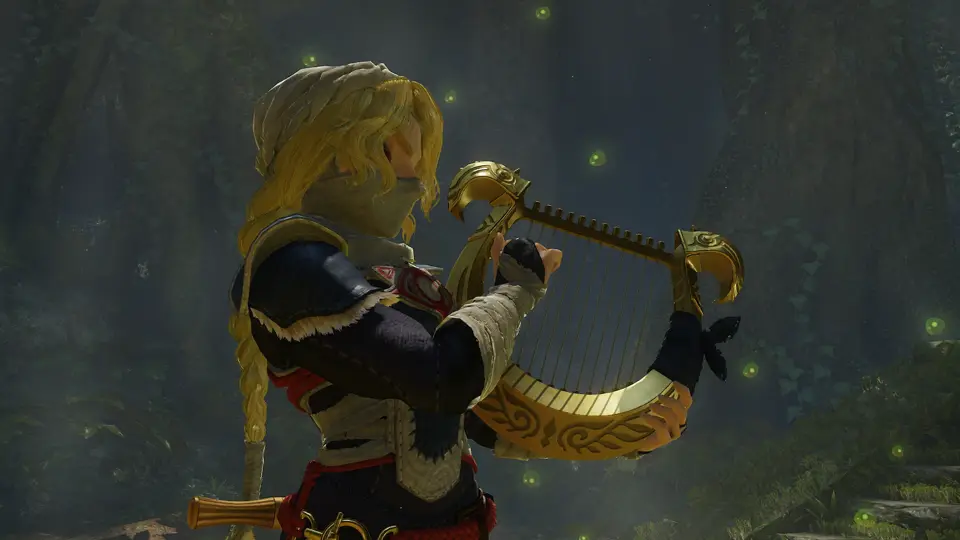

2026’s The Legend of Zelda: Ocarina of Time is a reverent remake, remaining true to all the silliness and solemnity of the original, modernizing some gameplay elements with an elegance that feels so natural, it’s as if it had always been there, and respecting the original design ethos enough to trust that all of the exploration and adventure will still feel great. For fans, to play this remake is to remember over and over again why you fell in love with Ocarina in the first place, and to see the brilliance with fresh eyes. For newcomers, this is now the definitive way to experience this all-time classic, and it’s a can’t-miss Switch 2 exclusive for everyone else.

In case you’re coming to this entirely fresh, Ocarina of Time was the first 3D Zelda game. This is the game that established series mainstays like Epona, Z-targeting, and the Goron and Gerudo. The Zelda series would not be the same without Ocarina of Time, so it holds a special place in the hearts of Zelda fans and in the history of Nintendo. Alongside Super Mario 64, this set the template for decades of the company’s development. And since Nintendo tends to blaze trails that others follow, it was also remarkably influential on the industry as a whole. 

Advertisement

The most noticeable change to Ocarina 2026, naturally, is to the presentation, and the upgrade is stellar. Put simply, this is one of the best-looking Switch 2 games and a showpiece for the system. Link and the Kokiri children have been given careful plant-fiber stitching to their clothes, driving home the idea that they’re forest sprites innately connected to the woods they occupy. Light glints off the titular Ocarina of Time as if it’s a real piece of glazed ceramic. The brick textures of dungeons look decrepit and lived-in, and become spookier when lit by the dim glow of your fairy friend, Navi. Boss creatures crumble into purple ash and collapse into dust when defeated. Every piece of this world has been lovingly crafted, and as a returning fan, I was consistently wowed by how gorgeous it looks.

The revamped presentation extends beyond just the graphical fidelity and into detailed touches in animation and sound design. You can actually see Link’s cheeks puff up when he blows into his ocarina, and his individual finger movements at least appear to track with the notes. When you reach the Lost Woods, following the directional sound cues is a more fully realized spatial experience. The reorchestrated music throughout the game sounds just as stirring and majestic as it did in 1998, blending in seamlessly with my memories. 

Many of the characters have been given full voice acting for cutscenes and certain pieces of dialogue, and they are across-the-board well-performed, imbuing their characters with personality and heart. Ganondorf’s actor sinks his teeth into the villainous role with gusto and menace. King Darunia the Goron’s actor is hearty and cheerful. Link’s childhood best friend, Saria, sounds heartfelt and sweet. Impa is a no-nonsense badass. The child version of Princess Ruto was a personal favorite, a pushy but lovable little scamp. Navi’s voice sounds a little older but still childlike, and often functions as Link’s voice, since he remains silent aside from his battle barks and shocked reactions. 

Link and Ruto

The one drawback to the addition of voice acting is Sheik, through no fault of the performer. I previously wondered how the Ocarina remake would handle that particular twist, and the answer is that it tries but ultimately fails to strike a satisfying balance. The dialogue makes it clear that the game wants to maintain its original intent, but both the revised character model and the voice acting make it less believable. The actor does as great a job as the rest of the cast, but it’s difficult to maintain a plot revelation that, in hindsight, relied so heavily on the limitations of the N64. At a certain point, it strains credulity that Link and Navi don’t just figure it out.

That minor point aside, though, the new cutscenes lend more drama to what was already one of my favorite Zelda stories. There’s more emphasis on facial expressions and finely detailed animation work to show gestures, so key moments hit with that much more weight. Saria’s tearful goodbye to Link at the edge of Kokiri Forest is a perfect example of this. Saria does all the talking and Link remains silent, which could risk feeling uncomfortable or odd. Instead, Link’s tiny moment of hesitation before he turns toward his destiny suggests that he feels just as warmly towards her but isn’t sure how to say it. It’s a lovely little moment that establishes a deep bond. 

Advertisement

Other times, the cutscenes simply make plot points more explicit than they were in the original. When Link first picks up the Master Sword and Ganondorf capitalizes on the opportunity, we physically see him exploiting the situation. I had to refer back to the original to confirm that this wasn’t new information–it was just making clearer a story beat that had always been intended. 

Kokiri Village

And while this remake hews very closely to the original design, it does add a few quality-of-life features that help smooth and modernize the experience. The most impactful of these is the addition of a jump button, which is simply excellent. The original Ocarina lacked a jump button due to the limitations of the controller and Nintendo exploring this new 3D space, and the remake on the 3DS retained that original design. In the 2026 game, the jump button feels completely natural and fits right into the stage and dungeon design as if it had always been there. Ocarina was never a game with difficult platforming challenges, but it feels great to be able to freely determine your own jumps, or to hop up onto a vine or ladder before you get there to speed up traversal. There was some degree of skepticism among fans at adding a jump button, but having now played Ocarina of Time with one, it’s hard for me to imagine going back.

Other additions are less impactful but still appreciated. The equipment bar returns from the Breath of the Wild and Tears of the Kingdom games, letting you easily pull up the piece of gear you need for a given challenge. Similarly, both the boots and your newly minted Lenses of Truth (they look more like goggles now) are mapped to directional buttons for quick toggling. You can only have one pair of boots or the other mapped to the quick-toggle, but it’s still a vast improvement over manually switching in the menu. 

One of my favorite new QOL additions is the Business Scrub. You can buy or find seeds that summon this Deku shopkeeper anywhere in the world, including in dungeons, and he sells a handful of necessary staples like potions, bombs, and arrows. That means no more trekking out of a dungeon to refill your potions before you take on a boss. At the same time, you don’t want to waste the seeds unless you really need them, so it doesn’t drain the adventure of all its challenge. 

Link learns Zelda’s Lullaby

Then there are broader additions, like the Threads of Time. This is essentially a quest tracker that points you in the right direction for the main story quest, as well as any side quests that you’ve begun. Some of the quest puzzles in Ocarina can be fairly abstract, and this doesn’t really function as a hint system so much as a reminder of where you left off. It’s also visually satisfying, filling in a tapestry of Link’s adventures with more detail as you complete more quests. The tapestry itself looks wonderfully textured, and it was always fun seeing the ways in which new boss monsters or quest elements would be visualized in its style. A similar addition is the Hall of Fallen Foes, a statuary of all the beasts and bosses you’ve defeated across Hyrule. It’s nothing revolutionary, but it is nice to have the opportunity to really soak in the visual detail of these designs without fighting against them, and for the bosses you can challenge them to a rematch to sharpen your skills. 

Advertisement

All of this is additive to the actual classic game, which holds up remarkably well. The dungeon design remains among the best in the series, even in this first 3D attempt. The land of Hyrule is absolutely packed with things to do, secrets to uncover, and people to help. It remains very digestible as a main quest, which is one reason it has invited replaying for so many years, but it’s also dense with activities and side quests to explore.

And to my delight, it retains the incredible strangeness of the original Ocarina of Time as well. Zelda games always have at least a little bit of zany charm, but Ocarina was weirder than most, with absolutely bizarre NPC designs and moments of wacky slapstick, like waking up the ranch owner Talon after he fell asleep in the Hyrule Castle grounds. Do you still have to carry a cross-legged Princess Ruto above your head like you’re giving a dolphin-child a piggyback ride? You bet! Those moments still give the world a humorous contrast. Link’s journey is ultimately a serious one, full of moments that feel heroic and triumphant, but having these silly moments sprinkled throughout help break the tension.

Ganondorf appears

Meanwhile, the darker elements are intact as well, and even enhanced. The first time adult Link ventures out of the Temple of Time to see a ruined Hyrule is supposed to feel tragic, and it’s delivered here with appropriate gravity. Some boss monsters are especially horrific and creepy, like the mini-boss Dead Hand. The Cursed Rich Man is a true jump-scare. Even the ReDead are pretty startling, though they’re revised slightly with clearer visual indicators that make them less frustrating to encounter. 

Because it is so reverent, the weaker parts of the original Ocarina of Time are still the weakest parts of its remake. The Water Temple is much more visually readable, but raising and lowering the water level can still be mildly annoying. The Shadow Temple is more linear and weaker than the other dungeons and heavily relies on its hidden-objects gimmick. The free camera and jump button make the stealth sections in Hyrule Castle and the Gerudo Fortress easier to manage, but the Gerudo one in particular is still a chore. To me, those felt like minor concessions for retaining and respecting the original design. It simply wouldn’t feel like Ocarina of Time if it tossed out these moments of friction, so this is partly an act of curation.

Sheik

When Nintendo remade Ocarina of Time for the 3DS in 2011, it was still within a certain era of Zelda games. It was released just a few months before Skyward Sword and years before the series had reinvented itself with Breath of the Wild. The context at the time was that this was a touched-up version of a classic 3D Zelda, but in the same recognizable format as what was then considered the current Zelda template. Now, against the backdrop of Breath of the Wild and Tears of the Kingdom, a remake of Ocarina of Time carries a different responsibility. This isn’t merely revisiting an older Zelda in a recognizable form; it’s revisiting another era of Zelda entirely. That gives it a certain weight, and raises the question of whether this form of Zelda can still feel modern. 

Advertisement

The answer is yes. Ocarina of Time is still a wonder of game design and a thrilling adventure. This remake smooths over some rough edges, leaves others intact, and lets what was so special about the original shine through. It can be easy to forget after so many years, but the core structure and design ethos are as strong as they ever were. By approaching this remake with a degree of reverence and respect for the source material, Nintendo has shown that a true masterpiece can stand the test of time.
